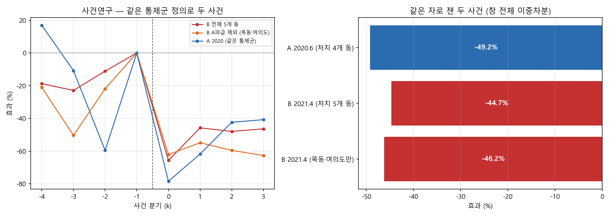

# 6주차 결과 보고서

**서울 아파트 실거래와 정책 공고를 결합한 미시 패널 구축과 토지거래허가구역 인과효과 추정**

2026-10-08 · 6주차 (D-43) · 저장소 https://github.com/cosmicpotato2047/capstone-ltz-causal

원자료 스냅샷: 실거래 2026-09-03 수집(분석 8개 자치구 472,782건 · 서울 25개 자치구 1,407,186건), 공고는 2026-08-20 공고분(국토교통부 제2026-1105호)까지. 이 보고서의 숫자는 이 스냅샷 기준이다.

> **[5주차 보고서](week-05.md)는 2026-10-08 에 소급 작성했다.** 그 주에는 10월 2일 중간 발표 준비가 겹쳐 넘어갔다가 뒤늦게 채웠다. M3(분석 종료)를 10/01에 채우고 이틀 뒤 발표했다.

---

## 요약

**제안서가 차별점으로 내건 "2020 / 2021 / 2025 다중 시점"에서 비어 있던 2021을 채웠다.** 그리고 그것이 이 연구의 가장 큰 약점 — 처치 동이 넷뿐 — 을 메운다.

1. **B그룹(2021.4 압구정·여의도·목동·성수)에서도 같은 크기의 거래량 감소가 나왔다.** 두 사건을 같은 통제군 정의로 다시 재면 A −49.2%, B −44.7%다.
2. **두 패널을 쌓아 차이를 직접 추정했다. 차이는 +8.7%, p 0.715로 0과 구분되지 않는다.** 외적 타당성은 "비슷해 보인다"가 아니라 **"다르다고 할 수 없다"**로 쓴다.
3. **기준점을 넷으로 바꿔도 −41.7 ~ −44.9%다.** 3%p 안이다.
4. **면적 이질성은 방향만 맞다.** 소형이 덜 줄었다는 부호는 2020과 같지만 40㎡ 미만 거래가 35건이라 세울 수 없다.
5. **착수 전에 `TREATED_2021`에서 성수동2가가 빠져 있던 것을 고쳤다.** 그 상수를 쓰는 스크립트가 없어 기존 결과에는 영향이 없다.

자세한 것은 [결정기록 0031](../decisions/0031-2021-B그룹-외적타당성.md).

---

## 1. 왜 이것을 했나

제안서 129행의 차별점 매트릭스는 처치 구조를 이렇게 적었다.

| 항목 | 전상현 | 이한웅 | 양지영 | 본 연구 |
|---|---|---|---|---|
| 처치 구조 | 2020.6 단일 | 2020.6 단일 | 2020.6 단일 | **2020 / 2021 / 2025 다중 시점** |

그리고 105행에 선행연구의 공통 한계로 *"모두 처치를 2020년 6월 단일 사건으로 취급한다. **2021년 4월의 2차 지정**, 2025년의 해제·재지정은 반영되지 않았다"*고 적었다.

**이행 상태가 2/3이었다.** 2020과 2025는 했고 2021은 없었다.

**그리고 아이러니가 있었다.** 지금까지 2021-04-27은 **통제군을 오염시키는 존재로만** 등장했다. 압구정동을 [0020](../decisions/0020-오염동-제외-강건성.md)에서 뺐고 성수동1가·2가를 [0009](../decisions/0009-통제군-오염-점검.md)에서 걸렀다. 선행연구가 2021년을 안 봤다고 지적하면서 우리도 처치로 쓴 적이 없었다.

**동시에 가장 큰 약점을 메우는 자리다.** 처치 동이 넷뿐이라 "17,550가지 중 1위"([0019](../decisions/0019-적은-클러스터-추론.md))는 *그 넷이 우연이 아니다*일 뿐 *다른 동에서도 그렇다*가 아니다. 둘은 다른 주장이다.

---

## 2. 설계 — 핵심은 대칭이다

**B그룹 숫자를 A그룹 숫자 옆에 그냥 놓으면 안 된다.**

A는 같은 구 안(강남·송파)을 통제군으로 썼다. B는 그럴 수 없다.

| 구 | 같은 구 안에 쓸 수 있는 비지정 동 |
|---|---|
| 영등포구 | 21개 |
| 성동구 | 8개 |
| 강남구 | 7개 |
| **양천구** | **0개** |

목동이 속한 양천구에 쓸 동이 없다(신월동은 2021-04-04 오염, 나머지는 창 안 거래 30건 미만). 목동은 처치 거래의 47%라 뺄 수 없다.

그러면 A와 B의 차이가 **지역 때문인지 통제군 때문인지** 가릴 수 없다. 그래서 둘을 한다.

**(가) 두 사건을 같은 통제군 정의로 다시 잰다.** 서울 전역 비지정 동이다. A의 주 사양(−79.8%)은 그대로 두고 여기 재추정은 비교용이다.

**(나) 두 패널을 쌓아 차이를 직접 추정한다(stacked DID).** 두 숫자를 눈으로 견주면 "차이가 유의한가"를 말할 수 없다. [0015](../decisions/0015-대출규제-처리.md) 2절에서 표본을 갈라 따로 추정해 놓고 차이를 말했다가 09-11에 정정했다. 같은 실수를 반복하지 않는다.

### 통제군에서 뺀 것

| 뺀 것 | 왜 |
|---|---|
| 창 안에 **어떤 계열로든** 지정 구간이 걸친 동 77개 | 2021-04-04에 다른 계열로 무더기 지정이 있었다 |
| A그룹 처치동 4개 + **맞닿은 동 14개** | 창(2020-04 ~ 2022-04)에 2020-06 지정이 들어 있다 |
| 상대 사건의 처치동 | 두 사건이 서로의 통제군을 오염시키지 않게 |
| 창 안 거래 30건 미만 | 얇은 칸 |

남은 통제동은 B가 **177개**, A가 **229개**다.

### 설계상 발견 — B그룹 셋이 A그룹 맞닿은 동이다

**압구정동·성수동1가·성수동2가**가 2020 지정의 파급을 받은 동이다. [0024](../decisions/0024-파급효과-기준점.md)가 맞닿은 동이 −9.0% 움직였다고 쟀고, 그 구간이 2021 사건의 **사전 구간에 그대로 들어 있다.**

그래서 처치군을 둘로 나눠 돌렸다 — 전체 5개 동과 **목동·여의도만**.

---

## 3. 결과



### 3.1 차이가 0과 구분되지 않는다

| | 값 |
|---|---|
| B − A 차이 계수 | +0.0837 → **+8.7%** |
| WCR 양측 | **0.777** |
| 무작위화 | 3,576 / 5,000 (**p 0.715**) |

**B가 A와 다르다고 할 수 없다.** 이것이 이 작업의 답이다.

### 3.2 같은 자로 잰 두 사건

창 전체(±12개월) 이중차분이다.

| 사양 | 효과 | WCR 양측 | 무작위 p |
|---|---|---|---|
| A 2020.6 (처치 4개 동) | **−49.2%** | 0.038 | 0.0002 |
| B 2021.4 (처치 5개 동) | **−44.7%** | 0.057 | 0.0008 |
| B 2021.4 (목동·여의도만) | −46.2% | 0.136 | 0.0012 |

**목동·여의도만으로도 −46.2%다.** 사전 구간의 A그룹 파급이 결과를 만들지 않았다.

지정 직후(사건연구 k=0)로 보면 A **−78.5%** 대 B **−65.7%**다.

> **−49.2%와 −79.8%를 섞어 쓰면 안 된다.** 앞은 창 전체 이중차분, 뒤는 지정 직후 3개월이다. 재는 것이 다르다.

**[0028](../decisions/0028-사양곡선.md)이 덤으로 확인됐다.** A를 강남·송파 내부 통제로 재면 k=0이 −79.8%, 서울 전역 통제로 바꾸면 **−78.5%**다. 사양 곡선이 통제군 축을 2.3%p로 잰 것과 맞는다.

### 3.3 기준점을 바꿔도 안 흔들린다

| 기준점 | 효과 | 동 |
|---|---|---|
| ① 서울 전역 비지정 | −44.7% | 182 |
| ② ① + 가격대 공통지지 | −41.7% | 39 |
| ③ 오염 미제외 | −43.8% | 233 |
| ④ A그룹 맞닿은 동 포함 | −44.9% | 188 |

**−41.7 ~ −44.9%**, 3%p 안이다.

### 3.4 면적 — 방향은 맞는데 세울 수 없다

2021 지정의 허가 기준도 **대지 18㎡ 초과**로 2020과 같다. [0022](../decisions/0022-면적-면제-검증.md)의 메커니즘이 맞다면 B그룹에서도 소형이 덜 줄어야 한다.

| 경계 | 소형이 더 움직인 폭 | WCR 양측 |
|---|---|---|
| 30㎡ | — | 처치동 소형이 3개 동 미만 |
| **40㎡** | **+108.1%** | **0.047** |
| 50㎡ | +47.8% | 0.114 |
| 60㎡ | +70.0% | 0.108 |

**부호가 전부 양수 — 소형이 덜 줄었다.** 2020과 같은 방향이다. 그러나 40㎡ 미만 거래가 **35건**(2020은 322건)이고 경계를 올리면 유의성이 사라진다.

**B그룹은 소형이 거의 없다.** 중위 전용면적은 A 84.8㎡ · B 85.0㎡로 **같은데** 40㎡ 미만 비중이 A 8.4% 대 **B 1.2%**다. 압구정동과 성수동2가는 **0건**이다.

**메커니즘의 반증이 아니라 검정력의 한계로 적는다.** 대지지분 대리값이 B그룹에서 더 부정확하다는 문제도 있다 — B그룹은 1970~80년대 재건축 대상 단지라 용적률이 낮아, 같은 전용면적이라도 대지지분이 클 수 있다.

### 3.5 가격 — B는 사후 후반이 양수다

| k | −4 | −3 | −2 | −1 | 0 | 1 | 2 | 3 |
|---|---|---|---|---|---|---|---|---|
| A 2020.6 | +5.3 | +7.8 | +4.1 | 0 | −1.6 | −5.2 | −8.5 | −10.0 |
| B 2021.4 | −0.3 | −1.2 | −2.8 | 0 | −1.3 | −0.4 | **+4.2** | **+4.1** |

**B는 사전이 깨끗한 대신 사후 후반이 양수다.** 2021-10 ~ 2022-04는 서울 가격 정점이고 B그룹은 재건축 대상 단지라 기대가 더 실렸을 수 있으나 **가릴 수 없다.** 가격은 [0001](../decisions/0001-주결과변수-거래량.md)대로 부 결과로만 쓴다.

---

## 4. 이번 주에 확정된 숫자

| 무엇 | 값 | 어떻게 쟀나 |
|---|---|---|
| B − A 차이 | **+8.7% (p 0.715)** | stacked DID, 두 패널 ±12개월 |
| B 2021.4 거래량 | **−44.7%** | 창 전체 DID, 서울 전역 비지정 통제 |
| B 지정 직후 (k=0) | **−65.7%** | 사건연구, 기준 k=−1 |
| A 2020.6 (같은 통제군) | **−49.2% / k=0 −78.5%** | 비교용 재추정 |
| 기준점 사다리 | −41.7 ~ −44.9% | 통제군 4종 |
| 면적 차이 (40㎡) | +108.1% (0.047) | 삼중차분, 소형 35건 |

---

## 5. 마일스톤 점검

| | 목표 | 상태 |
|---|---|---|
| M1 주 분석 확정 | 4주차 (09/24) | **09/18 충족** |
| M2 하이라이트 | 7주차 (10/15) | **09/23 충족** |
| M3 분석 종료 | 10주차 (11/05) | **10/01 충족** |
| M4 최종본 | 12주차 (11/19) | 진행 중 |

M3를 5주 일찍 넘겨 생긴 여유를 **외적 타당성**에 썼다. 백로그 21은 필수가 아니라 선택 항목이었다.

---

## 6. 미해결 사항과 다음 작업

**미해결**

- **WCR과 무작위화가 갈린다.** WCR 0.057 ~ 0.136인데 무작위화는 p 0.0008이다. 처치 동이 5개(목동·여의도만 쓰면 2개)라 [0019](../decisions/0019-적은-클러스터-추론.md)와 같은 상황이다. 둘 다 적는다.
- **기준분기 민감도가 A보다 넓다.** k=0 효과가 −55.5 ~ −65.7%로 10%p 폭이다(A는 −73 ~ −80%, 7%p).
- **B그룹 면적 이질성을 세우지 못했다.** 소형 35건.
- **가격 사후 후반의 양수를 설명하지 못했다.** 재건축 기대인지 시장 정점인지 가르지 않았다.
- **무작위화가 전수가 아니다.** 5,000벌 표본이다. 2020 사건의 17,550가지 전수와 같은 종류의 진술은 아니다.

**다음 작업 (M4, 11/19)**

| 날짜 | 내용 |
|---|---|
| 10/16 | 백로그 20 결과 대시보드 · 백로그 15 클린 환경 재현 1차 |
| 10/23 | 백로그 14 최종 보고서 초고 · 10/30 발표 자료 |
| **10/30** | **최종 발표 — 규제를 거느냐가 아니라 어떻게 거느냐** |
| 11/19 | M4 최종본 |

---

## 부록: 재현

```
python scripts/21_b_group.py
```

산출: `output/results/21_b_group.json` · `output/figures/21_b_group.png`

전체 파이프라인은 `python run_all.py` (42단계).
